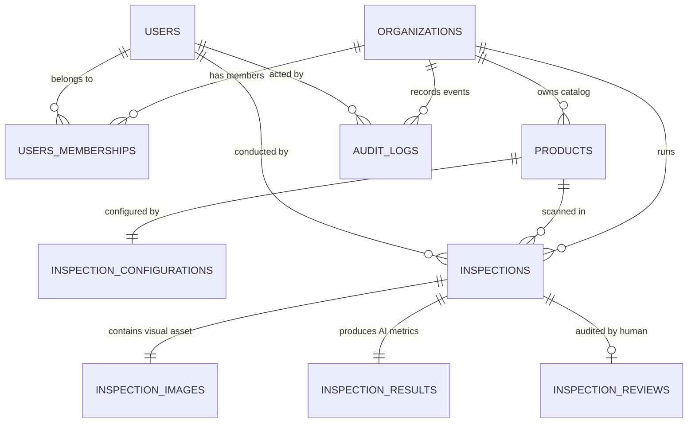

# Ironory — Data Governance & Database Architecture Audit

**Document ID:** IRONORY-AUD-009  
**Product:** Ironory (B2B Industrial AI Quality Inspection SaaS)  
**Lead Database Architect:** PostgreSQL & Data Modeling Specialist  
**Database Engine:** PostgreSQL 14+ / 15+ (SQLAlchemy 2.0 ORM, Alembic Migrations)  
**Audit Date:** 2026-11-16  

---

## 1. Entity-Relationship Schema Architecture

The Ironory relational database schema is strictly normalized and partitioned around tenant organizations to ensure complete isolation and zero cross-tenant contamination.

---

## 2. Entity Specifications & Constraint Audit

| Table Name | Primary Key | Tenant Key (`organization_id`) | Foreign Keys & Cascade Actions | Unique Constraints | Performance Indexes |
|---|---|---|---|---|---|
| `users` | `id` (UUID) | N/A (Global) | None | `email` | `email`, `id` |
| `organizations` | `id` (UUID) | Self | None | `slug` | `slug`, `id` |
| `organization_memberships` | `id` (UUID) | `organization_id` | `users.id` (CASCADE), `organizations.id` (CASCADE) | `(user_id, organization_id)` | `user_id`, `organization_id`, `role` |
| `products` | `id` (UUID) | `organization_id` | `organizations.id` (CASCADE) | `(organization_id, code)` | `organization_id`, `code`, `sku` |
| `inspection_configurations`| `id` (UUID) | Inherited via Product | `products.id` (CASCADE) | `product_id` (1-to-1) | `product_id` |
| `inspections` | `id` (UUID) | `organization_id` | `organizations.id` (CASCADE), `products.id` (CASCADE), `users.id` (SET NULL) | None | `organization_id`, `product_id`, `status`, `created_at` |
| `inspection_images` | `id` (UUID) | Inherited | `inspections.id` (CASCADE) | `inspection_id` (1-to-1) | `inspection_id`, `sha256_hash` |
| `inspection_results` | `id` (UUID) | Inherited | `inspections.id` (CASCADE) | `inspection_id` (1-to-1) | `inspection_id`, `predicted_class` |
| `inspection_reviews` | `id` (UUID) | Inherited | `inspections.id` (CASCADE), `users.id` (SET NULL) | `inspection_id` (1-to-1) | `inspection_id`, `decision` |
| `audit_logs` | `id` (UUID) | `organization_id` | `organizations.id` (SET NULL), `users.id` (SET NULL) | None | `organization_id`, `actor_id`, `action`, `resource_type` |
| `invitations` | `id` (UUID) | `organization_id` | `organizations.id` (CASCADE) | `token` | `organization_id`, `token` |
| `refresh_tokens` | `id` (UUID) | N/A | `users.id` (CASCADE) | `token_hash` | `user_id`, `token_hash` |

---

## 3. Data Integrity & Cascade Deletion Safety

1. **Orphan Prevention:** Deleting an organization automatically cascades deletion to products, configurations, and inspection records via PostgreSQL foreign key constraints (`ondelete="CASCADE"`).
2. **Audit Preservation (SET NULL):** If an operator or quality manager leaves the company and their user record is deleted, foreign keys `inspector_id` and `reviewer_id` in inspections and `actor_id` in `audit_logs` are set to `NULL` rather than cascading. This guarantees that historical quality inspection certificates and compliance records remain fully intact.
3. **Tenant-Scoped Uniqueness:** Product codes and SKUs are constrained per tenant:
   `UniqueConstraint("organization_id", "code", name="uq_organization_product_code")`
   Different manufacturers can independently utilize standard codes (e.g., `PART-001`) without namespace collisions.

---

## 4. Migration History & Version Tracking

All database schema evolutions are managed via Alembic revisions:
- `12087203d6b0`: Initial foundation schema (`users`, `organizations`, `organization_memberships`).
- `85c4333ddae4`: Products and core inspection tables (`products`, `inspection_configurations`, `inspections`, `inspection_images`, `inspection_results`, `inspection_reviews`).
- `f5bcd75eb21f`: Invitations and secure refresh token storage (`invitations`, `refresh_tokens`).
- **PENDING MIGRATION (`IRONORY-DATA-001`):** Generation of Alembic version script for `audit_logs` table (`backend/app/models/audit.py`).

---

## 5. Industrial Compliance & Retention Policy

To comply with automotive quality standards (IATF 16949) and aerospace requirements (AS9100):
- **10-Year Active Retention:** All inspection records, bounding boxes, and review decisions must be retained online for 10 years.
- **Cold Storage Tiering:** Visual assets (high-res raw scans and heatmaps) older than 90 days are automatically transitioned from high-speed SSD to AWS S3 Glacier Instant Retrieval via S3 lifecycle rules.
- **WORM (Write Once, Read Many):** S3 bucket policies prevent deletion or overwriting of archived inspection artifacts during the mandatory retention window.
