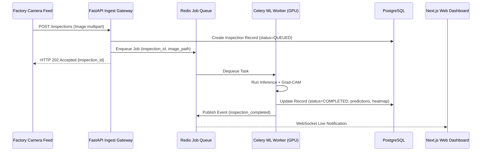

# Ironory — DevOps, SRE & Deployment Readiness Blueprint

**Document ID:** IRONORY-AUD-008  
**Product:** Ironory (B2B Industrial AI Quality Inspection SaaS)  
**Lead DevOps / SRE Architect:** Systems & Cloud Infrastructure Specialist  
**Deployment Targets:** On-Premises Industrial Edge Servers & AWS / GCP Cloud Kubernetes  
**Audit Date:** 2026-11-16  

---

## 1. Container Infrastructure Audit

### 1.1 Docker Topology Overview
The repository provides a multi-container orchestration definition via `docker-compose.yml`:
- `db`: PostgreSQL 14/15 database with persistent volume `ironory_postgres_data`.
- `redis`: Redis 7 Alpine with healthcheck and persistent volume `ironory_redis_data`.
- `backend`: FastAPI Python 3.11 web service on port 8000.
- `frontend`: Next.js 14 standalone Node 20 runtime on port 3000.

### 1.2 Identified Container Packaging Blockers

| File | Line Reference | Issue Description | Operational Impact | Recommended Fix |
|---|---|---|---|---|
| `backend/Dockerfile` | Lines 18-24 | Does not copy `ml/` directory into image | Container crashes when `inspection_execution_service` imports `ml.inference.service` | Add `COPY ml/ /app/ml/` to Dockerfile |
| `backend/Dockerfile` | Line 19 | Installs only `backend/requirements.txt` | Missing `tensorflow`, `reportlab`, `opencv-python-headless` | Merge ML dependencies into backend build or create dedicated ML inference worker image |
| `docker-compose.yml` | Line 10 | Hardcoded fallback credentials (`ironory_secret_pass`) | Security vulnerability if run without explicit `.env` | Enforce mandatory `.env` variable checking |
| `docker-compose.yml` | Line 11 | Default DB name `visioninspect` | Naming drift from Ironory product branding | Change default DB name to `ironory` |
| `frontend/Dockerfile` | Line 35 | Expects `.next/standalone` output | Standalone build requires `output: 'standalone'` in `next.config.js` | Ensure `next.config.js` specifies `output: 'standalone'` |

---

## 2. GPU Acceleration Blueprint

Industrial manufacturing lines requiring $< 30\text{ ms}$ inspection latency per frame necessitate GPU-accelerated inference.

### 2.1 Proposed `Dockerfile.gpu`
```dockerfile
# Ironory GPU Acceleration Runtime
FROM nvidia/cuda:12.2.0-runtime-ubuntu22.04

ENV DEBIAN_FRONTEND=noninteractive \
    PYTHONUNBUFFERED=1 \
    PATH="/venv/bin:$PATH"

RUN apt-get update && apt-get install -y --no-install-recommends \
    python3.11 python3.11-venv python3-pip libgl1-mesa-glx libglib2.0-0 \
    && rm -rf /var/lib/apt/lists/*

WORKDIR /app
COPY backend/requirements.txt /app/backend_req.txt
COPY ml/requirements.txt /app/ml_req.txt

RUN python3.11 -m venv /venv && \
    pip install --upgrade pip && \
    pip install -r /app/backend_req.txt -r /app/ml_req.txt

COPY backend/ /app/backend/
COPY ml/ /app/ml/

CMD ["uvicorn", "backend.app.main:app", "--host", "0.0.0.0", "--port", "8000"]
```

### 2.2 Docker Compose GPU Reservation
```yaml
deploy:
  resources:
    reservations:
      devices:
        - driver: nvidia
          count: all
          capabilities: [gpu]
```

---

## 3. Asynchronous Worker Architecture (Recommended Phase 2)

Currently, inference is executed synchronously inside FastAPI HTTP workers:
```
Client POST /inspections ───> FastAPI Uvicorn Worker ───> Tensorflow Inference (400ms) ───> Response
```
Under production factory line load (multiple continuous high-speed conveyor lines), this blocks web workers.

### Production Target:


---

## 4. Disaster Recovery & Backup Plan

1. **PostgreSQL Point-in-Time Recovery (PITR):**
   - Continuous Write-Ahead Log (WAL) archiving to AWS S3 or MinIO.
   - Daily automated logical dumps (`pg_dump -Fc`) retained for 30 days.
2. **Tenant Visual Asset Storage:**
   - Visual inspection images stored on AWS S3 with Object Lock (WORM compliance for aerospace/automotive parts traceability).
   - Local edge cache on SSD array with least-recently-used (LRU) pruning after 7 days.
3. **Health Check Probes:**
   - Liveness probe: `GET /api/v1/health` (HTTP 200).
   - Readiness probe: `GET /api/v1/system/status` (verifies PostgreSQL connection, Redis ping, and ML model memory load).
