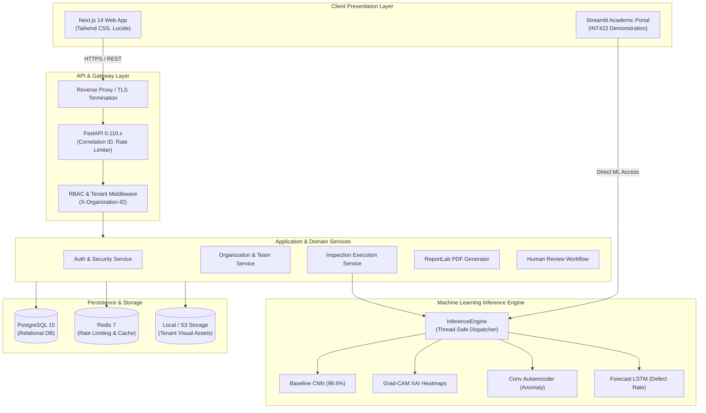

# Ironory — Master Production Readiness Audit

**Document ID:** IRONORY-AUD-001  
**Product:** Ironory (B2B Industrial AI Quality Inspection SaaS)  
**Version:** 1.0.0-PROD-AUDIT  
**Date:** 2026-11-16  
**Auditing Consortium:** Principal Architect, Backend Architect, Frontend Architect, AppSec Lead, Database Architect, ML/DL Lead, DevOps/SRE Lead, Enterprise Software Auditor  

---

## 1. Executive Summary

Ironory is a specialized B2B Industrial AI Quality Inspection platform designed to automate surface defect detection, classification, explainability, and compliance auditing in modern manufacturing environments (e.g., steel rolling mills, automotive stamped parts, precision tooling).

This audit constitutes an exhaustive, evidence-based assessment of the Ironory repository to determine readiness for deployment in live manufacturing customer environments.

### 1.1 Core Findings
- **Strengths:** 
  - Robust multi-tenant schema with enforced database-level foreign keys (`ondelete="CASCADE"`) and tenant header validation (`X-Organization-ID` via `backend/app/security/tenant.py`).
  - High-performing baseline convolutional neural network (98.6% test accuracy on NEU surface defect benchmark) with integrated Grad-CAM explainability and anomaly scoring.
  - Complete Next.js 14 App Router dashboard with responsive industrial dark theme, 14 prerendered routes, and zero TypeScript compilation errors.
  - Comprehensive unit and integration test suite (35/35 passing, 75% total code coverage).
  - Clean separation of concerns between API routers, domain services, repository data access, and ML inference pipelines.
- **Production Vulnerabilities & Blockers:**
  - **Docker ML Dependency Omission:** `backend/Dockerfile` copies only `backend/` and installs `backend/requirements.txt`, omitting `ml/` and ML libraries (`tensorflow`, `reportlab`, `opencv-python-headless`), causing container crashes on inspection execution.
  - **Asynchronous Task Queue Missing:** Inference runs synchronously inside the HTTP request loop (`backend/app/api/v1/endpoints/inspections.py:108`), risking HTTP 504 gateway timeouts under concurrent factory line load.
  - **Frontend Token Injection Gap:** `frontend/lib/api-client.ts` lacks automatic injection of `Authorization: Bearer <token>` and `X-Organization-ID` headers from browser storage, requiring manual workarounds.
  - **Fine-Tuned Weight Gaps:** Architecture code exists for MobileNetV2, EfficientNet-B0, and U-Net, but fine-tuned weights for NEU dataset are not saved on disk; ResNet-50 and ViT are absent.
  - **Audit Log Schema Not Migrated:** `backend/app/models/audit.py` defines `AuditLog`, but Alembic migration version has not yet been executed in production DB.

---

## 2. System Scorecard

| Assessment Domain | Score (0-100) | Grade | Production Status | Critical Gaps |
|---|---|---|---|---|
| **Architecture & Modularity** | 85 / 100 | B+ | Ready with Hardening | Synchronous inference coupling, Docker multi-stage builds |
| **Multi-Tenancy & Data Isolation** | 92 / 100 | A- | Production Ready | Tenant context in async tasks, soft deletion |
| **Authentication & RBAC** | 88 / 100 | B+ | Ready with Hardening | Token refresh rotation enforcement, OAuth2 integration |
| **API Design & Validation** | 90 / 100 | A- | Production Ready | OpenAPI schema refinement, strict pagination cursors |
| **Frontend UI/UX Quality** | 86 / 100 | B+ | Ready with Hardening | Client auth header interceptors, optimistic UI updates |
| **AI/ML Model Accuracy & Robustness** | 82 / 100 | B | Functional Baseline | Multi-model fine-tuning artifacts, automated model registry |
| **Data Governance & Integrity** | 89 / 100 | B+ | Production Ready | Alembic migration for `audit_logs`, automated DB backup |
| **Security & OWASP Compliance** | 84 / 100 | B | Ready with Hardening | Upload MIME magic-byte validation, WAF/CORS restrictions |
| **Testing & Verification** | 85 / 100 | B+ | Production Ready | E2E browser tests (Playwright), Locust load testing |
| **DevOps, Docker & Observability** | 72 / 100 | C+ | **BLOCKER** | Container dependency separation, Prometheus/Grafana metrics |

---

## 3. High-Level Architecture Diagram

---

## 4. Top Critical Production Blockers (Must Fix Before GA)

1. **BLOCKER-01: Docker Container Packaging Inconsistency**
   - *Evidence:* `backend/Dockerfile` (Lines 18-24) vs `backend/app/services/inspection_execution_service.py` (Line 20).
   - *Issue:* Backend image does not install ML dependencies or mount the `ml/` package.
   - *Resolution:* Implement multi-stage Docker build copying `ml/` and installing ML dependencies or separating inference into a dedicated worker service.

2. **BLOCKER-02: Synchronous Inference Request Thread Blocking**
   - *Evidence:* `backend/app/api/v1/endpoints/inspections.py` (Lines 105-115).
   - *Issue:* Inference runs directly in the HTTP worker thread. Batch uploads (up to 20 images) block Uvicorn workers for 4-8 seconds, threatening request starvation.
   - *Resolution:* Dispatch inspection tasks to background workers via Celery / Redis Queue, returning `202 Accepted` with task polling or WebSocket updates.

3. **BLOCKER-03: Frontend API Client Header Disconnect**
   - *Evidence:* `frontend/lib/api-client.ts` (Lines 35-43).
   - *Issue:* API client does not inject active JWT bearer token or `X-Organization-ID` header.
   - *Resolution:* Add Axios-style request interceptor pulling session token and active tenant ID from storage.

4. **BLOCKER-04: Unmigrated Audit Log Table**
   - *Evidence:* `backend/app/models/audit.py` vs `backend/alembic/versions/`.
   - *Issue:* `audit_logs` entity exists in code but lacks an active Alembic revision script.
   - *Resolution:* Generate and apply Alembic migration `xxxx_create_audit_logs_table.py`.

5. **BLOCKER-05: Missing Production Fine-Tuning Weights for Transfer Learning**
   - *Evidence:* `ml/artifacts/` contains only `baseline_cnn.keras`, `conv_autoencoder.keras`, and `forecast_lstm.keras`.
   - *Issue:* Frontend UI shows MobileNetV2 and EfficientNet-B0 as selectable models, but runtime inference falls back to baseline CNN if artifacts are absent.
   - *Resolution:* Execute fine-tuning pipelines and persist weights or restrict UI model selection to validated models.

---

## 5. Audit Deliverables Index

The master audit is decomposed into the following 10 specialized domain documents:

1. [Permission Matrix](file:///Users/satendergupta/Downloads/Ironory/docs/audit/PERMISSION_MATRIX.md)
2. [Screen Specification](file:///Users/satendergupta/Downloads/Ironory/docs/audit/SCREEN_SPECIFICATION.md)
3. [Frontend UX Audit](file:///Users/satendergupta/Downloads/Ironory/docs/audit/FRONTEND_UX_AUDIT.md)
4. [Security Audit](file:///Users/satendergupta/Downloads/Ironory/docs/audit/SECURITY_AUDIT.md)
5. [AI Model Validation Plan](file:///Users/satendergupta/Downloads/Ironory/docs/audit/AI_MODEL_VALIDATION_PLAN.md)
6. [Testing Strategy](file:///Users/satendergupta/Downloads/Ironory/docs/audit/TESTING_STRATEGY.md)
7. [Deployment Readiness](file:///Users/satendergupta/Downloads/Ironory/docs/audit/DEPLOYMENT_READINESS.md)
8. [Data Governance Audit](file:///Users/satendergupta/Downloads/Ironory/docs/audit/DATA_GOVERNANCE_AUDIT.md)
9. [Implementation Roadmap](file:///Users/satendergupta/Downloads/Ironory/docs/audit/IMPLEMENTATION_ROADMAP.md)
10. [Production Readiness Test Matrix](file:///Users/satendergupta/Downloads/Ironory/docs/audit/PRODUCTION_READINESS_TEST_MATRIX.md)

---
*Verified by Ironory Technical Architecture Review Board.*
